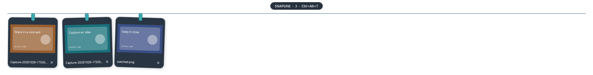

# SnapLine · 截图晾衣绳


把截图挂在 Windows 屏幕顶部。鼠标轻触上沿，截图就滑下来；复制、拖出分享、预览或交给画图编辑，都在手边。

参考 [Tendedero](https://github.com/alejandrobujan/tendedero) 的交互设计，使用 C# / .NET 10 / WPF 为 Windows 重新实现。独立项目、独立名称与图标，与原作者不存在背书关系。



## 下载与运行

前往 [Releases](https://github.com/Away6v/snapline/releases) 下载：

- 普通 Intel / AMD 电脑：`SnapLine-0.1.0-win-x64.exe`。
- Windows on ARM 电脑：`SnapLine-0.1.0-win-arm64.exe`。

下载后直接运行 EXE，无须安装 .NET 或管理员权限。程序在 EXE 所在目录的 `Data` 文件夹中保存设置和数据，请将 EXE 放在有写入权限的位置。发布页也提供 ZIP 包供旧版本自动更新使用。首次启动说明会提示剪贴板图片收集已开启；程序随后驻留系统托盘。

兼容目标为 Windows 10 22H2 与 Windows 11。本项目的兼容目标不等同于微软对旧系统的维护承诺。首版为未签名预发布版本，系统可能显示发布者未知；尚未提供代码签名或商店上架。可从托盘面板手动检查更新。

## 使用

| 操作 | 行为 |
| --- | --- |
| 鼠标在屏幕最上沿停留约 350 毫秒 | 在该屏幕展开晾衣绳 |
| `Ctrl+Alt+T` | 展开或收起，可在托盘面板中修改 |
| `Ctrl+Alt+M` | 切换文本和截图模式，可在托盘面板中修改 |
| 鼠标离开晾衣绳约 650 毫秒 | 自动收起 |
| `Win+Shift+S` 截图 | 从剪贴板自动收集图片 |
| 单击卡片 | 复制图片，出现“已复制”提示 |
| 双击卡片 | 用 Windows 默认图片应用打开 |
| 长按约 550 毫秒 | 用 Windows 画图编辑；外部图片先复制到收件箱 |
| 右键 | 预览、打开、编辑、另存为、定位文件、移除 |
| 拖到接收图片文件的应用或文件夹 | 依目标的复制／移动结果处理；取消时保留 |
| 滚轮 | 横向查看更早的图片 |
| 右键托盘图标 | 打开控制面板，可切换文本／截图、手动新建文本，并管理收集、保留数量、外观、语言与快捷键 |
| 双击托盘图标 | 展开或收起晾衣绳 |

在文本模式中，单击文本卡片复制全文，双击查看全文，右键可编辑或移除。短文本按内容自适应尺寸，较长文本最多显示六行；复制和编辑始终保留完整内容。剪贴板文本会自动收集且不会自动展开晾衣绳，也可在托盘面板关闭。文本与截图分别保存和设置保留数量。

遵循 Windows 拖放约定：默认复制，目标支持时按住 Shift 可移动。复制后保留卡片；确认源文件已移动后移除。各聊天软件接受的拖放格式可能不同。双击不再额外触发单击复制。隐藏窗口不抢占键盘焦点。

## 收集与存储

- 默认监控系统截图目录，托盘面板中可添加其他目录。只收集启动后新增或修改的图片，不批量导入目录中的旧图片。
- 支持 PNG、JPEG、BMP、GIF、TIFF；动图按第一帧显示。不包含录屏、视频、HEIC 或 WebP 解码承诺。
- 剪贴板截图和纯文本收集默认开启，可在托盘面板分别关闭。忽略文件复制、应用自己的复制及已识别的隐私排除标记；不能识别所有第三方应用的私有标记。
- 使用解码后的像素指纹去重，避免同一截图同时从目录与剪贴板重复出现。仍在晾衣绳上的相同图片不会新增第二份。
- 图片限制为 64 MB 文件／编码流、8000 万像素；剪贴板像素数据同样受像素上限限制。文本最多保留 100 条，可单独调整为 25、50 或 100 条。
- 默认数据目录：程序包中的 `Data`，包含 `state.json` 和 `Inbox`。移动整个程序包即可带走设置和收件箱截图；外部监控目录中的图片仍保留原路径。首次启动新版时会迁入旧位置的数据。仅保存在当前电脑，不上传、不分析。
- 点击移除或超过容量时：收件箱内图片进入回收站，外部图片只从列表移除。降低容量也会执行此规则，回收站操作失败时保留图片并提示。
- 编辑外部图片不会覆盖原图：创建收件箱副本，交给画图编辑，保存后更新卡片。若画图另存为其他位置，请将目标目录加入监控。
- 开机启动默认关闭。启用后记录当前 EXE 路径；移动解压目录后应重新保存开机启动设置。
- 开发或独立便携配置可设置 `SNAPLINE_DATA_DIR` 环境变量指定独立数据目录。该目录的 `Inbox` 同样遵循回收站规则。

试用时在运行命令后添加 `--show`，可启动后直接展开；鼠标离开后同样会自动收起。正常双击启动仍按鼠标悬停行为自动展开和收起。

## 构建

需要 Windows 和 [.NET 10 SDK](https://dotnet.microsoft.com/download/dotnet/10.0)。

```powershell
dotnet build -c Release
./scripts/build.ps1 -Runtime win-x64
./scripts/build.ps1 -Runtime win-arm64
```

`outputs/` 中生成便携目录、ZIP 与 SHA-256 校验文件。GitHub Actions 对 x64 与 ARM64 执行相同构建。交叉编译成功不代表对应架构已完成实机验证。

## 首版边界与验证

不包含录屏视频或内置标注编辑器。系统画图必须已安装；未安装时会提示。全屏检测使用前台窗口与显示器边界，独占游戏、远程桌面等特殊环境可能需要手动收起。截图期间是否包含晾衣绳取决于截图工具和当时窗口可见性。

验证结果与尚未实测的系统／设备详见 [发布说明](https://github.com/Away6v/snapline/releases)。使用问题请附 Windows 版本、CPU 架构、缩放比例和复现步骤，不要上传包含隐私的截图。

## 许可与致谢

[MIT](LICENSE)。原项目来源与上游许可边界见 [THIRD-PARTY-NOTICES.md](THIRD-PARTY-NOTICES.md)。新增和修改的代码注释使用中文，不提交个人截图、凭据、缓存或验证日志。

### 发布更新

在项目文件中更新 `Version`，提交更改并推送形如 `v1.2.3` 的版本标签。GitHub Actions 会构建 x64 和 ARM64 单文件 EXE、兼容更新的 ZIP 包及 SHA-256 校验文件，并创建带自动生成说明的正式 Release。可在 GitHub 编辑 Release 正文，软件检查更新时会展示该正文。发布前请检查版本号、发布说明和构建结果。软件仅检查最新正式版本；下载、校验后覆盖当前目录并重启，保留 `Data`。
